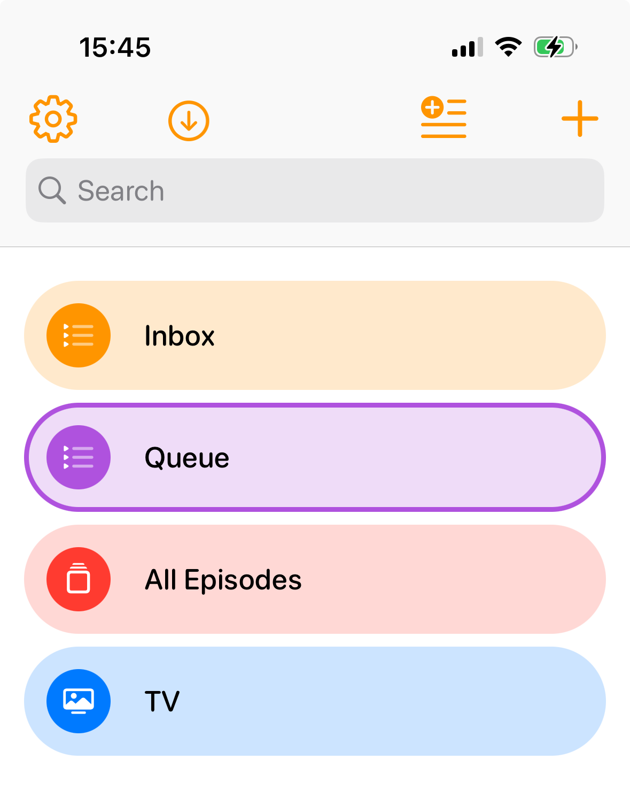
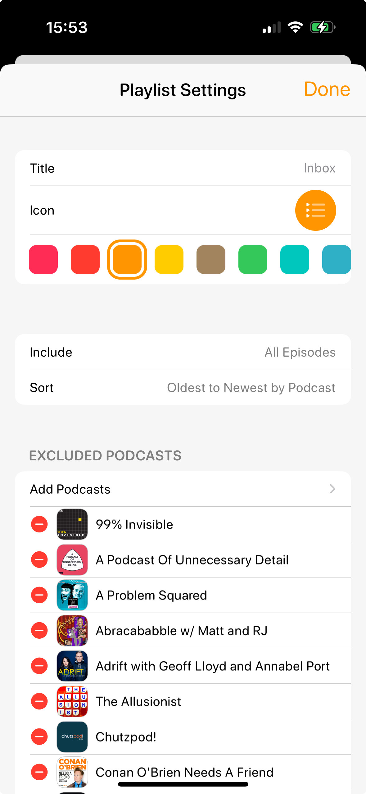
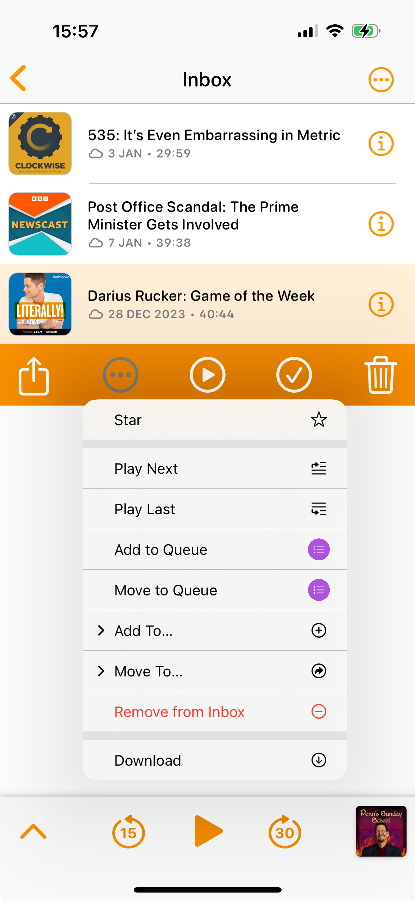
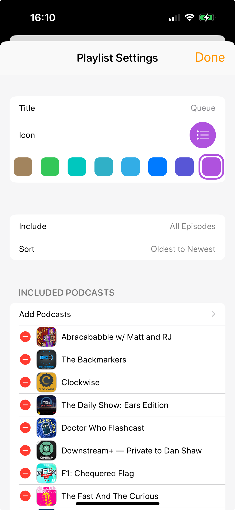

Since [Castro went down](https://sixcolors.com/post/2023/11/castro-podcast-app-goes-down-and-may-be-dying/) last month, I've been moving my
postcast listening to [Overcast](https://overcast.fm). I've been a fan of Overcast since launch, but Castro's inbox triage feature has always
meant that Castro was the app I ultimately used.

Now that Castro seems to be [down again](https://www.reddit.com/r/podcasts/comments/18ztfom/castro_down_again/), and now that I'm comfortable I have
a system which works for me, it's time for me to share how I set up Overcast to largely replicate the workflow I use for Castro.

## Things to note

This is how I listen to podcasts: it might not be how you listen to podcasts, so my workflow might not work for you

I subscribe to well over 100 podcasts, which fit into four categories:
1. Podcasts I listen to every episode of when there's nothing else for me to listen to - which I listen to in chronological order. This category by far contains the most unlistened podcast episodes
2. Podcasts I listen to some episodes of when there's nothing else for me to listen to
3. Podcasts I listen to every episode of as a priority
4. Podcasts I listen to some episodes of as a priority

Because of the number of podcasts I listen to, I always have a lot of episodes in Overcast. I never get to the point where I have nothing to
listen to... in fact, at the time of writing (Jan 2024) my oldest unlistened podcast episode is from April 2020

## The playlist setup

I have three playlists (actually four, but the fourth one is separate to my workflow)
* Inbox
* Queue
* All Episodes

## Inbox

This is a playlist which I _include all podcasts by default_. I do however, exclude those podcasts that I listen to all episodes of (categories 1
and 3). This is my equivalent of my Castro inbox: new podcasts come in here when they are to be triaged

When a new Podcast appears in this playlist, it means it's either a podcast episode that I might want to listen to straight away, listen to
eventually, or not listen to at all

If I want to listen to it (either eventually or straight away), I just remove it from the Inbox playlist. If I never want to listen to it, I delete it.
There might be an odd exception where it's a postcast I usually listen to eventually but I want to listen to this specific episode straight away -
in that cast, I move it to the Queue

## Queue

This is the playlist that I do my listening from. It is set up as a playlist to include those podcasts that I want to listen to straight away
(categories 3 and 4). Through logic, you can probably work out that category 4 podcasts are in both this playlist and the Inbox playlist: 
this is intentional - deleting them will remove them from both playlists, and if it's an episode I haven't triaged yet, I'd prefer to listen to it
and decide to skip the episode than to not have the episode in my queue

## All Episodes

This playlist contains all those podcasts which I want to listen to eventually (categories 1 and 2). I don't have any setup at all in this playlist:
it's simply literally all episodes from all podcasts. If I don't want to listen to the episode then they've already been deleted through my triage,
and I don't worry about those podcasts that I listen to as a priority, because I order from Oldest to Newest so I will never get that far down in the
playlist

I use this playlist in two ways, depending how I'm feeling.
1. If I decide that I should listen to a non-priority podcast episode, because I've been listening to too many priority podcasts, I will take
   the top episode of this playlist and select "Move to Queue". This will move it to the bottom of my listening queue. Note that because the
   playlist is called "Queue", Overcast makes this a very easy thing to do
2. If I've ran out of podcast episodes in my Queue playlist to listen to, then I will play the All Episodes playlist until more priority podcasts
   release episodes

## Quirks

There are one or two quirks to this setup: when first moving across to Overcast, the app doesn't know which episodes of which podcasts I've
listened to, so I found myself having to manually remove podcasts that found themselves in the wrong playlist because I'd already listened to
then in Castro. However, once my set up was complete, I've now used it for about a month with no problems

Questions? [Hit me up](http://thatdamnqa.com)
